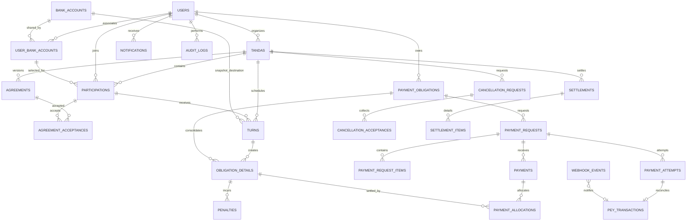

# Modelo lógico de datos

## 1. Propósito y límites

El modelo soporta usuarios, cuentas bancarias, tandas, participaciones múltiples, turnos, convenios, obligaciones, sanciones, solicitudes CoDi, conciliación Pey, pagos externos, incidencias, abandono, reasignaciones, pausas, cancelaciones, liquidaciones, notificaciones y auditoría.

PostgreSQL es la fuente de persistencia. Las reglas que involucran varias entidades se validan en servicios Spring Boot dentro de transacciones; las invariantes estructurales se protegen también con FK, UNIQUE, CHECK, índices y triggers.

La plataforma **no recibe, custodia ni distribuye fondos**. Pey gestiona los cobros CoDi.

## 2. Dominios y entidades

### Identidad y cuentas
- `users`: identidad de acceso.
- `bank_accounts`: cuenta registrada una sola vez en Pey; conserva `pey_bank_account_id` y estado del proveedor.
- `user_bank_accounts`: asociación autorizada usuario-cuenta, con declaración de titularidad y estado propio. Una cuenta admite como máximo cinco usuarios asociados.

### Administración de tandas
- `tandas`: configuración, organizador y ciclo de vida.
- `participation_requests`: invitaciones y solicitudes de ingreso, con aceptación/rechazo.
- `participations`: cada plaza/participación de una persona. Un usuario puede tener varias participaciones en una tanda.
- `agreements`: versiones inmutables del convenio.
- `agreement_acceptances`: aceptación explícita de una versión por participación.

### Turnos y calendario
- `turns`: posición, fecha original/actual, participación receptora y snapshot de la cuenta bancaria receptora.
- `turn_reservations`: reservas temporales durante la preparación.
- `turn_assignment_history`: asignaciones, liberaciones, cancelaciones y reasignaciones.
- `turn_schedule_history`: cambios de fecha; conserva la fecha anterior y la nueva.

### Obligaciones, cobros y pagos
- `payment_obligations`: obligación consolidada por tanda, usuario y periodo.
- `obligation_details`: desglose por turno receptor, importe y vencimiento.
- `payment_requests`: solicitud individual dirigida a una cuenta destino; conserva snapshot de esa cuenta.
- `payment_request_items`: conceptos incluidos: aportación o sanción.
- `payment_attempts`: intentos de QR o Push; una solicitud puede regenerarse conservando los intentos.
- `penalties`: sanción de cada detalle de obligación y periodo de retraso.
- `pey_transactions`: transacción consultada y validada contra Pey.
- `webhook_events`: eventos Pey, deduplicados por `webhook_id` y por `transaction_id`.
- `payments`: cobros y devoluciones, tanto Pey como externos.
- `payment_allocations`: aplicación de pagos confirmados a detalles de obligación o sanciones. Permite pagos externos parciales; cada uno requiere confirmación del receptor.

### Operación, trazabilidad y cierre
- `incidents`: discrepancias y situaciones que requieren revisión.
- `cancellation_requests` y `cancellation_acceptances`: solicitud de cancelación y voto de cada usuario involucrado.
- `settlements` y `settlement_items`: cálculo de liquidación y saldo neto por persona.
- `notifications`: notificaciones internas.
- `audit_logs`: registro de operaciones y cambios relevantes.

El esquema inicial contiene 29 tablas. Las migraciones posteriores completan restricciones y snapshots sin reescribir V1.

## 3. Relaciones y cardinalidades relevantes

- Un usuario se asocia con muchas cuentas y una cuenta puede asociarse con hasta cinco usuarios.
- Una tanda tiene un organizador y muchas participaciones. El organizador no participa automáticamente.
- No existe unicidad por `(user_id, tanda_id)`: varias participaciones de una persona son válidas.
- Cada participación selecciona explícitamente una asociación bancaria del mismo usuario.
- Un turno asignado referencia una participación receptora y conserva la asociación/cuenta bancaria y los datos de destino vigentes al asignarse.
- Una tanda tiene versiones de convenio; cada aceptación corresponde a una participación y una versión.
- Una obligación se consolida por usuario, tanda y periodo. Sus detalles conservan cada turno y participación receptora que originan el importe.
- Una solicitud de cobro puede agrupar conceptos compatibles del mismo pagador, periodo y cuenta destino. El backend valida que todos los conceptos compartan ese destino.
- Una solicitud tiene uno o más intentos QR/Push. El webhook solo notifica; la confirmación requiere consultar y conciliar con Pey.
- Un pago confirmado puede distribuirse entre varios detalles. Pagos externos parciales se acumulan únicamente después de la confirmación de la persona receptora.
- Una sanción pertenece al detalle de obligación y se calcula sobre la aportación base, nunca sobre sanciones anteriores.
- La cancelación activa requiere unanimidad de las personas involucradas. La liquidación registra saldos, no transferencias ejecutadas por la plataforma.

## 4. Diagrama entidad-relación (núcleo)

## 5. Flujo de cobro y conciliación

1. Al activar una tanda, se congela la distribución de turnos y cada turno conserva su cuenta receptora.
2. Por periodo se generan obligaciones consolidadas por usuario, excluyendo los turnos propios de todas sus participaciones.
3. Los detalles de obligación mantienen cada turno, receptor, destino y vencimiento.
4. El backend agrupa conceptos únicamente cuando corresponden al mismo pagador, periodo y cuenta destino.
5. Pey genera QR o Push. El sistema registra cada intento y no considera pagado por mostrar QR ni por recibir un webhook.
6. El webhook se valida sobre el cuerpo original y se deduplica; después se consulta la transacción a Pey.
7. Solo una transacción conciliada por importe exacto puede confirmar el cobro CoDi. Discrepancias quedan en revisión.
8. Los pagos externos pueden ser parciales, pero cada registro requiere confirmación de la persona receptora antes de aplicarse al saldo.

## 6. Reglas de conservación

- No borrar físicamente movimientos, aceptaciones, eventos de webhook ni auditoría.
- Cambiar la cuenta seleccionada en una participación no modifica turnos ya asignados ni solicitudes ya generadas.
- Reasignar un turno no transfiere obligaciones vencidas ni históricas: solo las futuras.
- Pausar/reanudar conserva fechas originales y registra las nuevas.
- La cancelación bloquea nuevas obligaciones y cobros; antes de cerrar se resuelven solicitudes/transacciones en curso y se calcula la liquidación.
